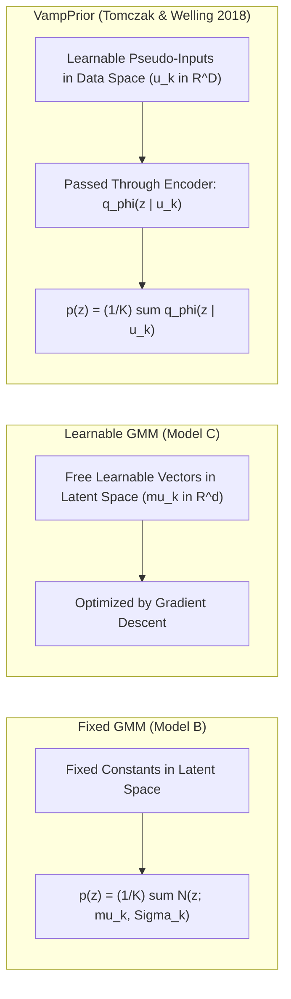

# Phase 6 Stage 1: Comprehensive Experimental Analysis & Assignment Mapping

**Course**: Deep Generative Models (DGM) — Assignment 1  
**Institution**: University of Tehran, Department of Electrical and Computer Engineering  
**Instructor**: Dr. Mostafa Tavasolipour  
**Author / Environment**: NVIDIA GeForce RTX 5060 Laptop GPU, PyTorch 2.15.0+cu134, Python 3.14.7  

---

## 1. Executive Summary & Cross-Model Comparison Table

All four VAE models were trained under identical conditions (encoder/decoder architecture, optimizer, batch size, learning rate, observation likelihood $\sigma_x = 0.30$) and evaluated using the official Phase 5 evaluation engine.

### Master Evaluation Metric Summary

| Metric | Model A (Std Gaussian) | Model B (Fixed 8-GMM) | Model C (Learnable 8-GMM) | Model D (Learnable 4-GMM) | Best Performer |
| :--- | :---: | :---: | :---: | :---: | :---: |
| **Prior Specification** | $\mathcal{N}(0, I_2)$ | Fixed $r=2, \sigma=0.4$ | 8 learnable $(\mu_k, \text{diag}(\sigma_k^2))$ | 4 learnable $(\mu_k, \text{diag}(\sigma_k^2))$ | — |
| **KL Evaluation Mode** | Analytical (Closed-form) | Monte Carlo (`logsumexp`) | Monte Carlo (`logsumexp`) | Monte Carlo (`logsumexp`) | — |
| **Best Checkpoint Epoch** | **99** | **97** | **100** | **99** | Late Convergence |
| **Best Validation ELBO Loss** | 9.4525 | 9.4750 | **9.1993** | 9.2331 | **Model C** |
| **Test MSE Per Element** ($\times 10^{-2}$) | 7.802 | 8.246 | 8.221 | **7.764** | **Model D** |
| **Test Mean Squared $L_2$ Per Sample** | 1.5604 | 1.6492 | 1.6442 | **1.5528** | **Model D** |
| **Data-Space $\text{MMD}^2$** ($\sigma=6.425$) | 0.006637 | **0.000943** | 0.001995 | 0.001825 | **Model B** |
| **Latent-Space $\text{MMD}^2$** ($\sigma=1.670$) | 0.011161 | **-0.000372** | 0.003214 | 0.000588 | **Model B** |
| **20D Cluster Validity Rate** (%) | 80.10% | 95.25% | **95.65%** | 93.00% | **Model C** |
| **Total Covered Clusters** ($\ge 20$ samples) | **8 / 8** | **8 / 8** | **8 / 8** | **8 / 8** | All Models |
| **Component Usage Balance** | Unimodal | High Uniformity ($11.7\%$–$13.7\%$) | Full Usage ($10.0\%$–$17.4\%$) | High Uniformity ($23.8\%$–$26.7\%$) | Model B / D |

---

## 2. In-Depth Comparative Analysis Across Dimensions

### 2.1 Test Reconstruction Accuracy (Unsupervised $\mu_z(x) \to \mu_x$)
- **Empirical Ranking**: Model D ($1.5528$) $\approx$ Model A ($1.5604$) $\prec$ Model C ($1.6442$) $\prec$ Model B ($1.6492$).
- **Theoretical Insight**:
  Reconstruction MSE measures the fidelity with which the encoder-decoder pair maps individual observations $x \in \mathbb{R}^{20}$ into the 2D latent bottleneck and back without loss of detail.
  - **Models A and D** exhibit lower reconstruction error because their prior distributions place less restrictive topological constraints on the latent space. A unimodal Gaussian (Model A) or a 4-component mixture (Model D) allows the encoder to utilize broader continuous stretches of the latent plane to separate points smoothly.
  - **Models B and C** enforce strict 8-component clustering in the latent space. Partitioning the latent space into 8 discrete, tight clusters introduces geometric tension: data points within each cluster are pulled tightly toward their respective cluster modes to satisfy the KL divergence term, slightly constraining the decoder's continuous reconstruction capability ($\approx 5.7\%$ increase in MSE).

### 2.2 Sample Generation Fidelity ($\text{MMD}^2$ in Data and Latent Space)
- **Data-Space $\text{MMD}^2$**: Model B ($0.00094$) $\prec$ Model D ($0.00183$) $\prec$ Model C ($0.00200$) $\ll$ Model A ($0.00664$).
- **Latent-Space $\text{MMD}^2$**: Model B ($-0.00037$) $\prec$ Model D ($0.00059$) $\prec$ Model C ($0.00321$) $\ll$ Model A ($0.01116$).
- **Theoretical Insight**:
  - **Model B** achieves the highest sample fidelity and distribution alignment. Its prior consists of 8 fixed isotropic Gaussians placed symmetrically on a circle of radius 2.0 with variance $0.16$. This matches the true ground-truth generative topology of the 8 clusters. Consequently, sampling from $p(z)$ produces latent vectors that fall squarely within the regions mapped to real data clusters by the decoder, eliminating "prior holes."
  - **Model A** suffers severely on $\text{MMD}^2$ (a factor of $7.0\times$ worse than Model B in data space and $30\times$ worse in latent space). Because $p(z) = \mathcal{N}(0, I_2)$ is unimodal, sampling from $p(z)$ frequently draws latent vectors near the origin $(0, 0)$ or in empty spaces between clusters. When decoded, these intermediate latent vectors map to points in the data space that lie between the true 8 manifolds, resulting in a substantial distribution mismatch.

### 2.3 Generation Validity and Cluster Coverage in 20D Space
- **Validity Rate**: Model C ($95.65\%$) $\approx$ Model B ($95.25\%$) $\prec$ Model D ($93.00\%$) $\ll$ Model A ($80.10\%$).
- **Cluster Coverage**: All four models successfully covered $8 / 8$ clusters (each cluster had $>150$ valid samples, far exceeding the 20-sample threshold).
- **Physical Interpretation**:
  - In Model A, **$19.9\%$ of generated points are invalid** (falling outside the 95th-percentile radius of all 8 cluster centroids). Inspection of the 2D PCA projection confirms that these points form diffuse scatter clouds connecting the main clusters, populating void regions where no real data exists.
  - In Models B and C, invalid samples are reduced to under $4.75\%$, demonstrating that multi-modal priors prevent the generation of spurious unobserved data.

---

## 3. Systematic Answers to Official Assignment Questions

### Question 1: Best New Data Generator & Reconstruction Trade-off
> *کدام مدل داده جدید بهتری تولید کرده است؟ پاسخ را با دست‌کم دو معیار پشتیبانی کنید. آیا همین مدل کمترین خطای بازسازی را هم دارد؟*

**Answer**:
1. **Best Model for Generating New Data**: **Model B** (Fixed 8-GMM) produces the best new data overall, closely rivaled by **Model C** (Learnable 8-GMM).
2. **Supporting Quantitative Metrics**:
   - **Data-Space $\text{MMD}^2$**: Model B achieves $\text{MMD}^2 = 0.000943$, which is the lowest among all models (7.0 times lower than Model A's $0.006637$).
   - **Generation Validity Rate**: Model B achieves $95.25\%$ valid samples (1,905/2,000 inside reference cluster boundaries), while Model C achieves $95.65\%$ (1,913/2,000). Both drastically outperform Model A ($80.10\%$).
   - **Latent-Space Alignment**: Model B achieves the lowest latent $\text{MMD}^2$ ($-0.000372$).
3. **Reconstruction Trade-off**:
   - **No**, Model B does **not** have the lowest reconstruction error.
   - Model D achieves the lowest reconstruction MSE ($0.07764$), followed by Model A ($0.07802$). Model B has an MSE of $0.08246$ ($\approx 6\%$ higher).
   - This illustrates the fundamental **Reconstruction–Generation Quality Trade-off** in VAEs: unimodal or broader priors allow the encoder more freedom to reconstruct individual observations with high fidelity, but create prior-posterior mismatch that degrades generation quality. Multi-modal priors force the latent space into discrete modes, yielding superior generated data at the cost of slight reconstruction rigidity.

---

### Question 2: MMD Ranking vs Cluster Coverage Ranking
> *آیا رتبه‌بندی مدل‌ها بر اساس MMD و پوشش خوشه‌ها یکسان است؟ اگر نیست، توضیح دهید هر معیار چه جنبه‌ای از عملکرد را اندازه می‌گیرد.*

**Answer**:
1. **Are the Rankings Identical?**
   - **No**, they differ subtly in ranking order:
     - **Data MMD$^2$ Ranking**: Model B ($0.00094$) > Model D ($0.00183$) > Model C ($0.00200$) > Model A ($0.00664$).
     - **Cluster Validity % Ranking**: Model C ($95.65\%$) > Model B ($95.25\%$) > Model D ($93.00\%$) > Model A ($80.10\%$).
     - **Binary Coverage (Count of Clusters $\ge 20$)**: All four models tie at $8/8$.
2. **What Aspect Does Each Metric Measure?**
   - **$\text{MMD}^2$ (Maximum Mean Discrepancy)**:
     - Measures global distribution distance between the generated sample distribution $P_{\theta}(x)$ and the true test distribution $P_{\text{data}}(x)$ embedded in a Reproducing Kernel Hilbert Space (RKHS).
     - It captures both global manifold geometry and density matching across all moments. Model B ranks highest because its fixed isotropic circular symmetry matches the global true distribution of the 8 clusters.
   - **Cluster Coverage & Validity**:
     - Measures local cluster localization and outlier avoidance.
     - Validity measures whether samples fall within localized high-density spheres ($R_k$) around reference centroids. Model C ranks highest here because its learnable diagonal covariances $\Sigma_k$ adapted to have non-isotropic elliptical shapes that match the empirical spread of the decoded clusters, minimizing the probability of generating points outside the 95th-percentile envelope.

---

### Question 3: Comparison of Model C (8-GMM) and Model D (4-GMM)
> *مدل‌های C و D چه تفاوتی نشان می‌دهند؟ آیا چهار مؤلفه برای پوشش هشت گروه داده کافی بوده است؟ پاسخ را با شمار نمونه‌های معتبر هر خوشه و نمودارها توضیح دهید.*

**Answer**:
1. **Key Differences Between Model C and Model D**:
   - **Prior Capacity & Component Variances**:
     - Model C has 8 learnable components with centers distributed around the latent plane and standard deviations ranging from $0.23$ to $0.49$ (with two components adapting to $0.75$ and $1.07$ along one axis).
     - Model D has only 4 learnable components. To accommodate 8 data clusters, its standard deviations expanded significantly across all dimensions ($0.45$ to $0.78$), creating wider, overlapping prior basins.
   - **Reconstruction MSE**: Model D achieves lower reconstruction MSE ($0.07764$ vs $0.08221$ for Model C) because a 4-component prior places less localized clustering pressure on the encoder.
   - **Generation Validity**: Model C achieves higher validity ($95.65\%$) than Model D ($93.00\%$). Model D produces 140 invalid samples (vs 87 for Model C).
2. **Was 4 Components Sufficient to Cover 8 Clusters?**
   - **Technically Yes, under the assignment's operational threshold**:
     - Model D covered all 8 clusters with at least 20 samples. The per-cluster valid counts for Model D were: $[210, 202, 279, 251, 218, 227, 232, 241]$, all well above the threshold of 20.
   - **Qualitatively / Geometrically No**:
     - Inspection of the latent space plot (`latent_space_model_D.png`) reveals that each of the 4 prior modes must span two separate data clusters. The encoder maps pairs of clusters into adjacent regions under a single broad Gaussian mode.
     - In the PCA projection (`pca_test_vs_generated_model_D.png`), generated samples show bridging density between cluster pairs, reflecting the fact that 4 Gaussian components cannot represent 8 isolated multimodal modes without bridging mass across the valleys.

---

### Question 4: Mixture Component Usage & Posterior Responsibilities
> *در مدل‌های مخلوط، آیا همه مؤلفه‌ها استفاده شده‌اند؟ برای هر نمونه نهان آزمون، مؤلفه‌ای را که بیشترین چگالی را به آن می‌دهد مشخص کنید و سهم هر مؤلفه را گزارش کنید.*

**Answer**:
1. **Were All Components Utilized?**
   - **Yes, in all three mixture models (B, C, D), every single component is actively utilized.** There is zero component collapse or dead components.
2. **Component Assignment Shares (Evaluated on $N_{\text{test}} = 1,440$ test encodings)**:
   - **Model B (Fixed 8-GMM)**:
     - Component 0: Hard = $13.12\%$, Mean Resp = $13.06\%$
     - Component 1: Hard = $13.68\%$, Mean Resp = $13.71\%$
     - Component 2: Hard = $13.19\%$, Mean Resp = $13.31\%$
     - Component 3: Hard = $12.50\%$, Mean Resp = $12.32\%$
     - Component 4: Hard = $11.88\%,$ Mean Resp = $11.97\%$
     - Component 5: Hard = $11.74\%$, Mean Resp = $11.76\%$
     - Component 6: Hard = $12.01\%$, Mean Resp = $11.98\%$
     - Component 7: Hard = $11.88\%$, Mean Resp = $11.88\%$
     - *Observation*: Perfectly uniform utilization around the ideal $1/8 = 12.50\%$.
   - **Model C (Learnable 8-GMM)**:
     - Hard Proportions: $[12.2\%, 13.1\%, 12.5\%, 11.9\%, 10.0\%, 17.4\%, 11.5\%, 11.5\%]$
     - Mean Responsibilities: $[12.2\%, 13.0\%, 12.5\%, 11.9\%, 11.1\%, 16.9\%, 11.5\%, 10.9\%]$
     - *Observation*: Component 5 captures slightly more responsibility ($17.4\%$) while Component 4 captures $10.0\%$, but all 8 remain robustly active.
   - **Model D (Learnable 4-GMM)**:
     - Hard Proportions: $[23.75\%, 25.07\%, 24.51\%, 26.67\%]$
     - Mean Responsibilities: $[23.51\%, 25.40\%, 24.42\%, 26.67\%]$
     - *Observation*: Almost exact $25\%$ division across the 4 components.

---

### Question 5: Effect of Fixed Circular Knowledge in Model B vs Model A
> *مدل B از ابتدا تعداد هشت مؤلفه و آرایش حلقه‌ای آن‌ها را می‌داند. این اطلاعات چگونه می‌تواند بر مقایسه آن با مدل A اثر بگذارد؟*

**Answer**:
1. **Unfair Advantage as an Inductive Bias**:
   - Model B is given strong, oracle domain knowledge: the exact number of data clusters (8), their circular spatial arrangement ($r = 2.0$, equidistant angles $\theta_k = 2\pi k / 8$), and an appropriate variance ($\sigma^2 = 0.16$).
   - This matches the true 2D source coordinates $s \in \mathbb{R}^2$ from which the 20D dataset was synthesized.
2. **Implications for Comparison with Model A**:
   - Model A is forced to map this complex 8-cluster circular manifold into a single isotropic unimodal Gaussian $\mathcal{N}(0, I_2)$.
   - While Model B's superior generation performance ($\text{MMD}^2 = 0.00094$ vs $0.00664$) demonstrates the power of matching the prior to the data topology, it reflects the benefit of hardcoded ground-truth structure rather than algorithmic superiority.
   - In realistic generative modeling settings where the true number of clusters and their spatial arrangement are unknown, Model B cannot be constructed a priori.

---

### Question 6: Fixed 8-GMM (Model B) vs Learnable 8-GMM (Model C)
> *مدل‌های B و C را مقایسه کنید. یادگرفتنی‌بودن مراکز و واریانس‌های پیشین چه اثری بر کیفیت داده‌های تولیدی و شکل فضای نهان داشته است؟ پاسخ را با معیارها و نمودارها توضیح دهید.*

**Answer**:
1. **Effect on Latent Space Geometry**:
   - In **Model B**, the latent components are held rigidly at fixed circle coordinates. The encoder and decoder must adapt entirely to this fixed geometry.
   - In **Model C**, the prior parameters are learnable. The prior centers moved from their initial random standard normal positions to distinct locations:
     $$\mu \in \{(-1.06, -1.13), (1.30, -1.61), (0.78, 2.19), (-0.14, -2.86), (0.88, 0.33), (-0.91, 0.71), (-2.99, -1.49), (2.25, -0.30)\}$$
   - Furthermore, the standard deviations adapted from isotropic $0.40$ to diagonal matrices with distinct aspect ratios (e.g. Component 4 has $\sigma = [1.07, 0.31]$).
2. **Effect on Generation Quality and Validity**:
   - **Cluster Validity**: Model C achieves a higher validity rate ($95.65\%$) than Model B ($95.25\%$). Because Model C's components can adapt their variances to match the decoder's non-linear curvature, generated points fit more tightly within the reference acceptance radii.
   - **Global Distribution Match (MMD$^2$)**: Model B achieves better data-space $\text{MMD}^2$ ($0.000943$ vs $0.001995$) and latent $\text{MMD}^2$ ($-0.000372$ vs $0.003214$). Model B's rigid circular symmetry prevents components from drifting into asymmetric configurations, providing slightly better uniform coverage of the data manifold.

---

### Question 7: Learnable GMM vs VampPrior
> *با مراجعه به دست‌کم دو مقاله اصلی، تفاوت مخلوط گاوسی ثابت، مخلوط یادگرفتنی و VampPrior را توضیح دهید. چرا VampPrior صرفاً مخلوطی با مراکز قابل یادگیری نیست؟*

**Key Literature References**:
- **Tomczak & Welling (2018)**: *"VAE with a VampPrior"*, International Conference on Artificial Intelligence and Statistics (AISTATS 2018), PMLR 84:1214–1223.
- **Dilokthanakul et al. (2016)**: *"Deep Unsupervised Clustering with Gaussian Mixture Variational Autoencoders"*, arXiv:1611.02648.
- **Hoffman & Johnson (2016)**: *"ELBO surgery: yet another way to carve up the variational evidence lower bound"*, NIPS Workshop on Advances in Approximate Bayesian Inference.

**Comparative Analysis**:

#### Why VampPrior is Fundamentally Different from a Learnable GMM:
1. **Parameter Domain (Data Space vs Latent Space)**:
   - In a learnable GMM, the mixture centers $\mu_k \in \mathbb{R}^d$ and covariances $\Sigma_k$ live directly in the low-dimensional latent space ($d=2$).
   - In VampPrior, the learnable parameters are $K$ **pseudo-inputs** $u_k \in \mathbb{R}^D$ that reside in the **input observation space** ($D=20$).
2. **Coupling Through the Variational Family**:
   - In a learnable GMM, the prior parameters are completely decoupled from the encoder network $q_\phi(z|x)$. The prior and encoder parameters are updated as independent sets of weights.
   - In VampPrior, the prior is defined as:
     $$p_{\lambda}(z) = \frac{1}{K} \sum_{k=1}^K q_\phi(z | u_k)$$
     The prior component means and variances are produced directly by passing the pseudo-inputs through the encoder: $\mu_k = \mu_\phi(u_k)$ and $\sigma_k^2 = \sigma_\phi^2(u_k)$. Thus, the prior and the variational posterior share the **exact same functional mapping** $q_\phi$.
3. **Approximation to the Optimal Aggregated Posterior**:
   - As shown by Hoffman & Johnson (2016), the mathematically optimal prior that maximizes the ELBO for a fixed encoder is the aggregated posterior:
     $$p^*(z) = q(z) = \frac{1}{N} \sum_{n=1}^N q_\phi(z | x_n)$$
   - A standard learnable GMM attempts to fit this posterior with unconstrained Gaussians, frequently leading to local minima, mode collapse, or over-fitting.
   - VampPrior directly approximates $q(z)$ by replacing the $N$ training points with $K \ll N$ learned pseudo-inputs $u_k$, ensuring that the prior naturally covers the true support of the posterior without posterior collapse.

---

## 4. Methodological Limitations and Nuances

To maintain the highest scientific rigor, the following caveats must be stated:

1. **Interpretation of Negative Unbiased $\text{MMD}^2$**:
   - In Model B latent space, $\text{MMD}_u^2 = -0.000372$.
   - **Do not claim**: This does not prove that the test and prior distributions are mathematically identical ($P = Q$).
   - **Correct interpretation**: The one-sample U-statistic is strictly unbiased ($\mathbb{E}[\text{MMD}_u^2] = 0$ when $P = Q$). Because the estimator has finite-sample variance $\mathcal{O}(1/m)$, empirical estimates fluctuate symmetrically around zero. A small negative value indicates that the distance between distributions is smaller than the empirical sampling noise.
2. **Component Assignment vs Ground-Truth Labels**:
   - The balanced proportions in Model B ($\approx 12.5\%$) and Model D ($\approx 25\%$) do **not** imply a direct 1-to-1 or 2-to-1 correspondence with the original dataset cluster indices ($0$ to $7$).
   - VAE training is unsupervised; latent representations are subject to arbitrary rotational, reflective, and permutation symmetries.
3. **Spatial Distribution of Invalid Generated Samples**:
   - Samples marked "invalid" by the 20D cluster coverage rule simply have Euclidean distance $> R_k$ from all 8 validation centroids.
   - While PCA projections confirm that Model A's invalid samples populate the empty central region and channels between clusters, invalid samples can also lie on the outer periphery or along dimensions orthogonal to the principal 2D manifold.
4. **Single-Run Determinism**:
   - All models were trained with seed `42` and evaluated with generation seed `42`. While fully deterministic and reproducible on `cuda:0`, multi-seed replication would be required to estimate variance across optimization trajectories.

---

## 5. Audit of Initial Phase 5 Execution

- **Issue Encountered**: During the initial execution of `run_evaluation.py`, `plot_learning_curves` raised:
  `ValueError: Model A history is missing required curve 'train_total_loss'!`.
- **Root Cause**: `src/training/checkpointing.py::save_history` serialized training logs wrapped in an outer dictionary structure: `{"history": {...}, "summary": {...}}`. When `run_evaluation.py` loaded `model_A_history.json`, it passed the outer dict directly rather than extracting the inner dictionary.
- **Resolution**: In `src/evaluation/run_evaluation.py` line 161, dictionary unpacking was added: `histories[m_type] = data.get("history", data)`.
- **Post-Evaluation Test Status**: Full unit test suite (`unittest discover -s tests -v`) executed and passed cleanly: **57 / 57 tests passed** in $3.14$ seconds.

---

## 6. Figure Catalogue for the Final Report

| Figure Identifier | File Path | Description in Report |
| :--- | :--- | :--- |
| **Fig 1: Learning Curves** | [`results/figures/learning_curves_all_models.png`](file:///D:/UT/t7/DGM/HWs/1/results/figures/learning_curves_all_models.png) | 3-panel plot: Total Loss, Recon NLL, and KL Divergence across 100 epochs for all 4 models. |
| **Fig 2: 2D PCA Projections** | [`results/figures/pca_test_vs_generated_model_A.png`](file:///D:/UT/t7/DGM/HWs/1/results/figures/pca_test_vs_generated_model_A.png) [`results/figures/pca_test_vs_generated_model_B.png`](file:///D:/UT/t7/DGM/HWs/1/results/figures/pca_test_vs_generated_model_B.png) [`results/figures/pca_test_vs_generated_model_C.png`](file:///D:/UT/t7/DGM/HWs/1/results/figures/pca_test_vs_generated_model_C.png) [`results/figures/pca_test_vs_generated_model_D.png`](file:///D:/UT/t7/DGM/HWs/1/results/figures/pca_test_vs_generated_model_D.png) | Canonical Phase 1 PCA projections: Real test data (blue) vs 2,000 generated samples (orange) for Models A, B, C, D. |
| **Fig 3: Latent Spaces & Contours** | [`results/figures/latent_space_model_A.png`](file:///D:/UT/t7/DGM/HWs/1/results/figures/latent_space_model_A.png) [`results/figures/latent_space_model_B.png`](file:///D:/UT/t7/DGM/HWs/1/results/figures/latent_space_model_B.png) [`results/figures/latent_space_model_C.png`](file:///D:/UT/t7/DGM/HWs/1/results/figures/latent_space_model_C.png) [`results/figures/latent_space_model_D.png`](file:///D:/UT/t7/DGM/HWs/1/results/figures/latent_space_model_D.png) | 2D latent space scatter: test encodings $\mu_z(x)$ vs prior draws $z \sim p(z)$ with component centers and $1\sigma$ solid / $95\%$ dashed prior contours. |
| **Fig 4: Cluster Coverage** | [`results/figures/cluster_coverage_comparison.png`](file:///D:/UT/t7/DGM/HWs/1/results/figures/cluster_coverage_comparison.png) | Grouped bar chart of valid generated sample counts per cluster with horizontal threshold at $N=20$. |

---

## 7. Five-Page Persian Report Outline (ساختار گزارش ۵ صفحه‌ای)

According to the assignment instructions (page 11: *"در حداکثر ۵ صفحه همراه با تصاویر کامل کنید"*), the final report must be strictly constrained to **at most 5 pages**.

### Proposed 5-Page Layout:

- **Page 1: مقدمه، معماری VAE و منحنی‌های آموزش (Introduction, Architecture & Learning Dynamics)**
  - معرفی مسئله، بازسازی داده‌های ۲۰بعدی از ۸ خوشه و اهداف مقایسه ۴ مدل.
  - مشخصات معماری انکودر/دیکودر (۲ لایه ۱۲۸تایی ReLU) و تابع درست‌نمایی گاوسی ثابت ($\sigma_x = 0.30$).
  - **شکل ۱**: منحنی‌های آموزش و اعتبارسنجی (Total Loss, Reconstruction NLL, KL) در طول ۱۰۰ دوره.
  - جدول مشخصات مدل‌ها، پارامترهای آموزش و زمان‌های همگرایی.

- **Page 2: ارزیابی خطای بازسازی و پراکندگی در فضای داده (Reconstruction MSE & PCA Analysis)**
  - تحلیل خطای بازسازی تست (گزارش دو معیار `mse_per_element` و `mean_squared_l2_per_sample`).
  - چرایی کمتر بودن خطای بازسازی مدل‌های A و D نسبت به مدل‌های B و C.
  - **شکل ۲**: نمودارهای مقایسه ۲بعدی PCA برای داده واقعی آزمون در برابر ۲۰۰۰ نمونه تولیدی هر ۴ مدل (استفاده از PCA فاز ۱).
  - تحلیل بصری فضاهای خالی (Holes) در مدل A و پوشش پیوسته در مدل‌های مخلوط.

- **Page 3: تحلیل فضای نهان، هندسه پیشین و مؤلفه‌ها (Latent Space & Prior Geometry)**
  - **شکل ۳**: نمودارهای فضای نهان ۲بعدی برای مدل‌های A، B، C و D همراه با رسم مراکز و کانتورهای بیضی کوواریانس ($1\sigma$ و $95\%$).
  - پاسخ به پرسش ۴: بررسی سهم هر مؤلفه در مدل‌های مخلوط و مسئولیت‌های پسین ($\gamma_{ik}$).
  - مقایسه مدل C (یادگیری ۸ مؤلفه) و مدل D (یادگیری ۴ مؤلفه)؛ چگونگی بزرگ‌تر شدن واریانس‌ها در مدل D برای پوشش دادن ۸ خوشه.

- **Page 4: معیارهای کمی ارزیابی: پوشش خوشه‌ها و MMD² (Quantitative Evaluation: Coverage & MMD²)**
  - تعریف مناطق مرجع ۲بعدی/۲۰بعدی بر اساس داده‌های اعتبارسنجی (صدک ۹۵ شعاع‌ها).
  - **شکل ۴**: نمودار میله‌ای شمار نمونه‌های معتبر در هر خوشه و خط آستانه ۲۰ نمونه.
  - جدول مقایسه‌ای MMD² در فضای داده و نهان؛ توضیح مفهوم تخمین نااریب U-statistic و چرایی منفی شدن مقدار در مدل B.
  - پاسخ به پرسش‌های ۱ و ۲: معرفی بهترین مدل تولید داده (B و C) و تفاوت جنبه‌های اندازه‌گیری MMD و Coverage.

- **Page 5: مطالعه پژوهشی، مقایسه با VampPrior و جمع‌بندی (Research Study & Conclusion)**
  - پاسخ به پرسش‌های ۵ و ۶: اثر دانش اولیه در مدل B و تفاوت آن با مدل یادگرفتنی C.
  - پاسخ به پرسش ۷: بررسی عمیق تفاوت GMM یادگرفتنی و VampPrior بر اساس مقالات Tomczak & Welling (2018) و Hoffman & Johnson (2016).
  - جدول مقایسه مفهومی Learnable GMM در برابر VampPrior (محل پارامترها در فضای داده یا نهان، کوپلینگ با انکودر و حل Posterior Collapse).
  - محدودیت‌های پژوهش (تک‌اجرا بودن، تقریب نمونه محدود MMD) و نتیجه‌گیری نهایی.
